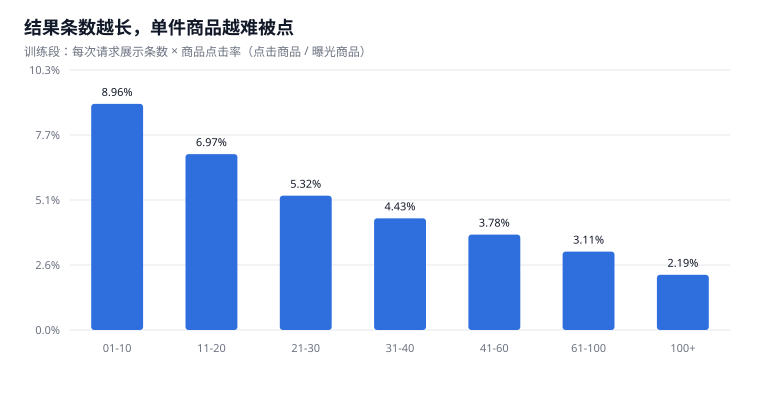
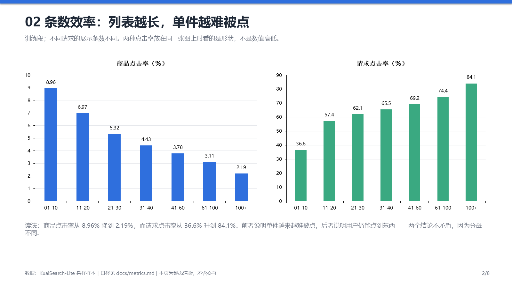
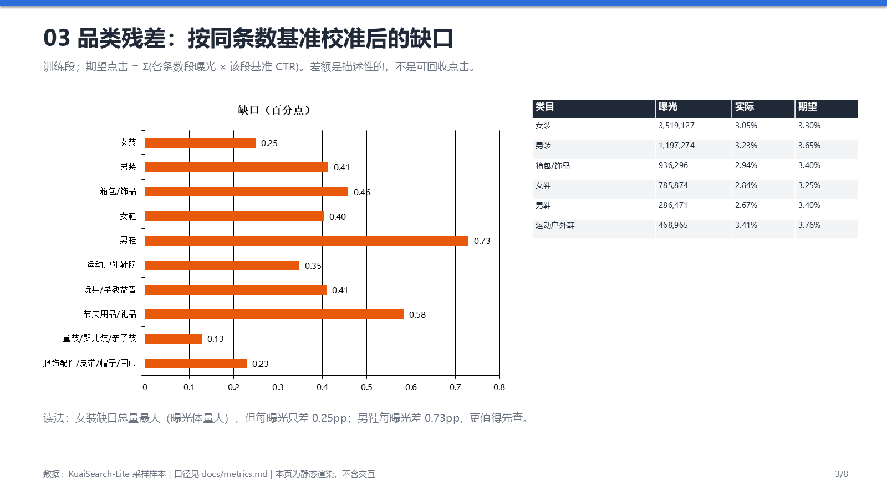

# 快手电商搜索需求与转化效率诊断

用 KuaiSearch-Lite 的真实搜索行为，回答一个运营问题：**哪些搜索需求有曝光、有需求，却没被结果页接住？**

> 555,553 次真实搜索 · 17,800,904 次商品曝光 · 102,086 名用户 · 278,615 个去重搜索词
> 数据来源：[KuaiSearch-Lite](https://huggingface.co/datasets/benchen4395/KuaiSearch)（2025 年 6 月后的快手电商搜索行为样本，Lite 为采样数据）

## 30 秒结论

**列表条数是解释商品点击率差异的重要分层变量。**当前数据支持描述性诊断，尚不能确定低点击的原因。

- 6.9% 的请求记录 ≥100 条商品曝光，贡献 **40.3% 的曝光**；这些请求的商品点击率为 **2.19%**，请求点击率为 **84.1%**。两种比率分母不同。
- 按"同展示条数"校准后，部分品类和规则需求标签的描述性差距缩小（女装差距从 0.78pp 收窄到 **0.25pp**）；需求标签尚未人工校核。
- 有 **124 个搜索词**满足样本门槛且低于同条数基准，集中在泛品类词：鞋子、衣服、外套、裤子、手机壳、卫衣、上衣。Top 30 的描述性期望差额约 **6,400 次点击**（约为其曝光的 1.0%）；这不是可回收点击或策略效果。现有显著性检验偏乐观，暂不把 q 值用于结论。




## 关键数字

| 指标 | 训练段 | 测试段（时间外） |
| --- | --- | --- |
| 搜索请求 | 539,012 | 16,541 |
| 商品曝光 | 17,306,633 | 494,271 |
| 商品点击率（点击商品/曝光） | 3.83% | 3.80% |
| 请求点击率（有点击的请求/请求） | 53.16% | 51.12% |
| 购买请求率（有购买的请求/请求） | 8.81% | 8.83% |
| 平均展示条数 | 32.1 | 29.9 |

| 结构发现 | 数值 |
| --- | --- |
| 100+ 条列表的请求占比 | 6.9% |
| 100+ 条列表的曝光占比 | 40.3% |
| 1–10 条 vs 100+ 条的商品点击率 | 8.96% vs 2.19% |
| 通过样本门槛且存在正缺口的搜索词 | 124 个（现有 q 值不用于确认性推断） |
| Top 30 缺口点击 | ~6,416 次 / 64.6 万曝光（~1.0%） |

## 已完成的验证

- **质量断言**：39 项对账（请求=会话、曝光=求和、位置越界 0、意图覆盖 100%），任一失败 `run.py` 中止且不覆盖旧库。
- **三路对账**：同一批数字用 DuckDB(库) / DuckDB(Parquet) / 纯 Python(聚合 CSV) 各算一遍，5 个核心指标全部一致（`outputs_public/engine_check.json`）。
- **确定性导出**：导出统一保留 10 位有效数字并加稳定排序键，连续两次全量重建的 14 个公开 CSV 哈希完全一致（耗时类字段除外）。
- **位置敏感性**：把召回列表中的位置也放进基准（条数 × 位置两层）后，Top 30 的描述性缺口变化最大 0.009pp（`outputs_public/sensitivity_position.csv`）。这不能识别用户实际看到的排序位或解释低点击原因。
- **第四引擎（Spark）**：Apache Spark 4.3.0 本地模式复算同一批指标，结果与 DuckDB 完全一致（`outputs_public/spark_check.json`）；启动 5.8s、聚合 1.4s/2.2s。详见 [技术栈](docs/tech-stack.md)。
- **看板**：`dashboards/preview.html` 可直接打开；本机另有 Power BI 八页 `.pbix`，涵盖总览、条数效率、品类残差、需求标签、机会清单、标题审阅、相对时间和运营动作。

## 方法：先校准口径，再谈机会

1. **两个分母严格分开**：商品点击率（点击/曝光）≠ 请求点击率（有点击的请求/请求）。
2. **按结果条数分层**：同一份数据，列表越长单件越难被点，用"同条数段期望点击"当基准，算残差而不是直接比总体。
3. **需求标签规则化**：品牌/店铺、品类+修饰、纯品类、属性/场景、无品类信号，规则在 `config/intent_rules.csv`，可审计、可替换。
4. **机会表附探索性统计列**：Wilson 区间 + 双比例检验 + BH-FDR。现有检验假设不充分，p/q 值不用于确认性结论；测试段只做方向复核（时间外，不是 A/B）。
5. **动作带实验设计**：每个动作有主指标、护栏指标、最小样本量（[实验方案](docs/experiment-design.md)）。

完整口径见 [指标口径](docs/metrics.md)，数据质量见 [数据字典](docs/data-dictionary.md)。

## 仓库结构

```
.
├── run.py                      # 一键重建：读原始 JSONL → DuckDB → 聚合导出
├── sql/
│   ├── 01_staging.sql          # 原始表清洗 + 质量审计
│   ├── 02_intermediate.sql     # 请求层、曝光层（含位置）、维度、需求标签
│   ├── 03_marts.sql            # 总览、条数分层、类目、需求、机会、时间、年龄
│   ├── 04_quality.sql          # 对账断言（任一失败即中止）
│   └── clickhouse/             # ClickHouse 建表 / 装载 / 校验 SQL（环境就绪即可跑）
├── src/
│   ├── pipeline.py             # 临时库构建 + 原子替换 + 导出
│   └── stats.py                # Wilson / 双比例检验 / BH-FDR
├── config/intent_rules.csv     # 需求标签规则
├── scripts/
│   ├── download_data.py        # 官方文件下载 + SHA-256 校验
│   ├── export_parquet.py       # 导出 fact/sessions 到 Parquet（跨引擎对账用）
│   ├── verify_engines.py       # 三路对账 + 耗时，写 engine_check.json
│   ├── setup_spark.ps1         # 免管理员安装 Spark 并修复 Windows 启动器
│   ├── spark_check.py          # Spark 本地模式复算 + 与 DuckDB 对账
│   ├── position_sensitivity.py # 条数 × 位置双层基准的敏感性复核
│   ├── build_review.py         # Top 10 词 × 10 商品自动预筛
│   ├── make_spotcheck.py       # 每词 3 行的空白抽检表
│   ├── apply_spotcheck.py      # 人工填写后生成聚合结果
│   ├── build_dashboard_data.py # 生成 Power BI 单文件数据源（xlsx）
│   ├── build_dashboard_preview.py # 生成静态看板预览（html）
│   └── make_charts.py          # README 图表（无第三方依赖）
├── outputs/                    # 本地全量（含 query 明细与商品标题，不发布）
├── outputs_public/             # 可公开的聚合结果 + 对账 JSON
├── exports/                    # Parquet 中间产物（不发布）
├── dashboards/                 # preview.html + Power BI 数据源 + 手册
└── docs/                       # 报告、口径、字典、证据、实验、技术栈、面试
```

## 快速开始

```powershell
python -m pip install -r requirements.txt
python scripts/download_data.py    # 下载官方 4 份 Lite 文件并校验 SHA-256（约 3.1 GB）
python run.py                      # 重建数据库 + 导出聚合结果（本机约 40 秒）

# 可选：验证与展示
python scripts/verify_engines.py   # 三路对账（DuckDB / Parquet / Python），写出 engine_check.json
powershell -ExecutionPolicy Bypass -File scripts/setup_spark.ps1  # 可选：装 Spark（免管理员）
python scripts/spark_check.py      # 可选：Spark 复算并与 DuckDB 对账
python scripts/build_review.py     # Top 10 词 × 10 商品自动预筛
python scripts/make_spotcheck.py  # 空白 30 行人工抽检表
python scripts/position_sensitivity.py    # 位置敏感性复核（条数 × 位置双层基准）
python scripts/export_parquet.py   # 导出 Parquet（ClickHouse 对账或免重建查询用）
python scripts/build_dashboard_data.py    # Power BI 单文件数据源（需要 openpyxl）
python scripts/build_dashboard_preview.py # 静态看板预览
python scripts/normalize_screenshots.py    # 截图统一裁切为 1600×900
python scripts/check_dashboard_assets.py   # 校验 PDF/截图（发布前必跑）
python scripts/make_charts.py      # 重新生成 README 图表
```

运行后：

- `data/processed/kuaisearch.duckdb`：本地分析库（不发布）
- `outputs/`：全量结果（含 query 明细与商品标题，不发布）
- `outputs_public/`：可公开聚合结果（看板数据源）
- `outputs/quality.json`：质量审计结果（任一断言失败，`run.py` 会中止且不覆盖旧库）

## 看板

已制作 Power BI Desktop 八页报告：总览 / 条数效率 / 品类残差 / 需求标签 / 机会清单 / 标题预筛 / 相对时间 / 运营动作。本机文件为 `dashboards/kuaisearch-search-ops.pbix`，其中含 Top 30 搜索词。`.pbix` 被 `.gitignore` 排除，克隆仓库不会获得它；确认数据许可和词级内容后，计划通过 GitHub Release 附件或网盘提供下载。搭建与口径见 [Power BI 手册](docs/powerbi.md)。

- 先看 [静态看板](dashboards/preview.html)（双击打开，无需安装任何软件）；`docs-site/index.html` 是 GitHub Pages 准备稿。
- [八页 PDF](dashboards/看板.pdf) 与下方截图为本机看板导出物；重新导出后运行 `python scripts/check_dashboard_assets.py` 校验页数、尺寸、空白页与截图中的应用界面条。
- 数据源：`dashboards/data/kuaisearch_dashboard.xlsx`（本版导入 11 张数据表；未导入年龄表）。
  




PDF 第 5 页含 Top 30 搜索词；示例词为样本中的高频泛词，公开前仍需核实其脱敏与再分发许可。

## 口径与边界

- 商品点击率以曝光为分母，请求点击率以请求为分母；同条数差额仅作描述性排查，没有线上实验结果。
- 购买标签不是订单，且没有金额字段；不计算 GMV。召回顺序不等于实际展示位。
- `time_index` 是相对编码；Lite 是采样数据，不能据此推断平台日历趋势或总体规模。
- 年龄字段异常、相关性标注覆盖不足；不作人群或商品相关性结论。

## 文档

| 文档 | 内容 |
| --- | --- |
| [分析报告](docs/analysis-report.md) | 完整业务报告：结论、证据、动作、限制 |
| [承接证据审阅](docs/evidence-review.md) | 商品级审阅表怎么读、怎么填、能得出什么 |
| [指标口径](docs/metrics.md) | 每个指标的分母、公式与使用边界 |
| [数据字典](docs/data-dictionary.md) | 字段、规模、质量审计、已知问题 |
| [实验方案](docs/experiment-design.md) | 3 个动作的假设、分流、主/护栏指标、样本量 |
| [Power BI 手册](docs/powerbi.md) | 已制作报告与后续优化版式的操作说明 |
| [技术栈](docs/tech-stack.md) | DuckDB 取舍、ClickHouse 对账资产、Spark 实测与选型建议 |
| [面试材料](docs/interview.md) | 30 秒/2 分钟讲法、10 个追问、简历表述 |
| [路线图](docs/roadmap.md) | 阶段计划、当前进度与验收标准 |
| [交接说明](docs/handoff-codex.md) | 给优化方的完整交接：结论、口径、文件地图、已知弱点与优化任务 |
| [交付与审阅指南](docs/delivery-guide.md) | 本机成果清单、建议审阅顺序、发布边界与反馈重点 |
| [数据许可](docs/data-license.md) | 数据集 MIT 核查记录、可发布清单、搜索词敏感性扫描 |

## 许可

代码 MIT。数据集 KuaiSearch-Lite 在 Hugging Face 标注为 MIT（核查记录见 [数据许可](docs/data-license.md)）；本项目不再分发原始文件与用户级数据。
